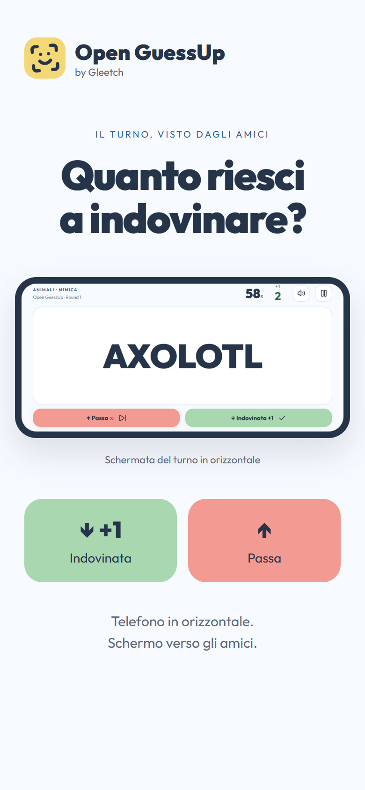

# Open GuessUp

**Versione 1.1.0 · by Gleetch**

**Tu non vedi. Loro ridono.** Un party game offline per Android e web, con un solo telefono, realizzato con Expo SDK 58, React Native e TypeScript. Progetto indipendente di Gleetch. Identità Confetti: rosso, verde, blu e giallo pastello su bianco freddo, con Outfit, logo e icona originali. [Note di design](docs/DESIGN.md).

[**Scarica l’APK Android 1.1.0**](https://github.com/PaoloConteDev/OpenGuessUp/releases/download/v1.1.0/OpenGuessUp-1.1.0-arm64.apk) · [Release e sorgenti](https://github.com/PaoloConteDev/OpenGuessUp/releases/tag/v1.1.0)

- Una partita rapida oppure 2–4 squadre, con nomi e durata personalizzabili.
- 12 categorie, 3.600 voci per lingua e mazzi personali modificabili.
- Italiano, inglese, spagnolo, francese e tedesco.
- Inclinazione su Android; pulsanti e tastiera per giocare anche sul web.
- Nessun account, pubblicità, acquisto, tracking o backend necessario.

<p align="center">
  
  
</p>

Home e schermata reale di gioco, presentate in formato portrait. Il turno si gioca in landscape, come mostrato nella seconda anteprima.

## Installare e aggiornare

Scarica l’APK su un telefono Android **ARM64 con Android 7 o successivo**, aprilo e consenti l’installazione dalla fonte scelta. L’app funziona senza Expo Go; dati, font, illustrazione e suoni sono inclusi per giocare offline dal primo avvio.

Se hai già installato la 1.0.0 di questa repository, apri il nuovo APK per aggiornarla conservando impostazioni, mazzi e partita salvata. La 1.1.0 mantiene package e certificato di firma; non serve disinstallare. Il file resta una build autonoma firmata con chiave debug, destinata a test e installazione diretta. I digest SHA-256 sono disponibili in `SHA256SUMS.txt` negli allegati della release.

## Novità della 1.1.0

- Identità Confetti a quattro colori pastello e illustrazione 3D originale nella home.
- Icona Android coordinata al simbolo della home, bandiere delle lingue e firma “by Gleetch”.
- Numero di versione aggiornato in tutta l’interfaccia, letto dalla configurazione dell’app.
- README con download, regole, configurazione e istruzioni di compilazione.

## Avvio

Richiede Node 22.13+ (qui verificato con 22.14), npm e, per il nativo, un client compatibile con Expo SDK 58 o un APK.

```powershell
git clone https://github.com/PaoloConteDev/OpenGuessUp.git
cd OpenGuessUp
npm.cmd ci
npm.cmd start
```

`npm run web` avvia l'anteprima web in sviluppo. Per l'export di produzione:

```powershell
npm.cmd run export:web
npm.cmd run preview
```

Apri [127.0.0.1:4174](http://127.0.0.1:4174). [Anteprima telefono](http://127.0.0.1:4174/__mobile).

## Giocare

1. Scegli e mescola categorie incluse e mazzi personali, oppure usa la categoria iniziale Animali.
2. Configura una partita rapida (un turno) oppure 2–4 squadre. Ogni squadra gioca un turno per ciascun round.
3. Tieni il telefono **in orizzontale sulla fronte**, schermo verso gli amici. Premi Calibra: hai 3 secondi per posizionarlo, poi resta fermo per circa un secondo. Avvia il countdown; la parola appare solo dopo il via.
4. Gli amici seguono il tipo di indizio: descrivere senza dire la risposta; mimare senza parlare; cantare/fredonnare senza nominare l'artista o il titolo; imitare senza fare il nome. Per le scene bisogna indovinare l'intera situazione, non soltanto il personaggio.
5. Inclina **in basso** per indovinata (+1), **in alto** per passare. Torna alla posizione verticale dopo ogni gesto. Sono sempre disponibili anche i pulsanti.
6. Alla fine rivedete e correggete gli esiti, quindi confermate. Una parola senza risposta vale zero. Vince il punteggio più alto; tutti i primi a pari merito vincono.

Nel browser: **↓ indovinata**, **↑ passa**, **spazio pausa/riprendi**. I tasti tenuti premuti non producono risposte ripetute. Gli input funzionano anche col pool di una sola parola.

| Opzione           | Valori                                         |
| ----------------- | ---------------------------------------------- |
| Durata            | 30, 45, 60, 90, 120 secondi                    |
| Squadre           | 2, 3, 4; nomi modificabili                     |
| Round             | 1, 3, 5, 7 per squadra                         |
| Risposta corretta | +1                                             |
| Passaggio         | 0 predefinito, oppure −1                       |
| Limite passaggi   | Illimitato predefinito, 0, 3, 5, 10            |
| Feedback          | Suono e vibrazione separatamente disattivabili |

Il timer usa una scadenza temporale, non il conteggio degli intervalli. Il background e la perdita di focus web mettono in pausa e nascondono la parola; serve una ripresa esplicita con nuovo countdown. Il tempo si ferma durante la pausa; il breve feedback di un esito consuma tempo del turno. Le parole non si ripetono prima dell'esaurimento del pool; alla nuova mescolata si evita anche la ripetizione sul confine, se il pool contiene più di una voce.

## Categorie e lingue

**12 categorie × 300 voci × 5 lingue = 18.000 versioni localizzate di 3.600 voci.** I conteggi nell'app vengono dai dati, non da etichette statiche.

| Categoria             | Indizio                      | Voci per lingua |
| --------------------- | ---------------------------- | --------------: |
| Animali               | Mimica                       |             300 |
| Cibo                  | Descrizione                  |             300 |
| Oggetti quotidiani    | Descrizione                  |             300 |
| Luoghi                | Descrizione                  |             300 |
| Natura e scienza      | Descrizione                  |             300 |
| Sport in scena        | Mimica                       |             300 |
| Musica e artisti      | Canto / imitazione strumento |             300 |
| Azioni da mimare      | Mimica                       |             300 |
| Mestieri e imprevisti | Imitazione                   |             300 |
| Fiabe sottosopra      | Imitazione                   |             300 |
| Emozioni in scena     | Imitazione                   |             300 |
| Viaggi e disavventure | Indizi liberi                |             300 |

Italiano, inglese, spagnolo, tedesco e francese includono interfaccia, regole, metadati e voci. Prima lingua dal dispositivo, fallback inglese; il selettore con bandiere salva la preferenza. Un cambio lingua non traduce la partita in corso: la sua copia delle parole resta nella lingua di creazione.

I pacchetti contengono sia parole sia espressioni e scene complete. Animali, cibo e altri repertori condividono parte del lessico originale del progetto dell'utente Open Taboo; sono state aggiunte specie, piatti, artisti e scene originali per Open GuessUp. I pacchetti di scene combinano protagonisti, azioni e vincoli: ad esempio «Un vampiro va dal dentista» è una situazione da recitare. Non sono presenti liste di parole vietate o dati estratti da GuessUp. La localizzazione è inclusa e controllata automaticamente per integrità e duplicati; resta consigliabile una revisione editoriale da madrelingua per terminologia specialistica e naturalezza di alcune scene.

`src/data/content.json` è autosufficiente e versionato; gli ID sono hash stabili della voce italiana nella sua categoria. Per correggere una traduzione, mantenere l'ID. Nessun dato viene scaricato durante il gioco.

## Mazzi personali e salvataggi

Creazione, modifica, colore e cancellazione dalla schermata Categorie. Una voce per riga; normalizzazione Unicode, spazi e doppioni senza distinguere maiuscole. Massimo 100 caratteri per voce e 3.000 voci per mazzo. Il nome è obbligatorio; un mazzo vuoto si può salvare ma non selezionare.

Ogni mazzo appartiene alla lingua di creazione. La partita salva una **copia completa** delle parole, così rinominare o eliminare il mazzo non altera il gioco riprendibile. AsyncStorage usa `@open-guess/state-v1` e `@open-guess/language-v1`. Salvataggi assenti/corrotti vengono gestiti con valori sicuri; errori di scrittura vengono segnalati senza interrompere il gioco. Durante il turno si salva anche un checkpoint ogni due secondi; una chiusura forzata può perdere fino a due secondi di progresso.

## Sensori e orientamento Android

`expo-sensors` legge l'accelerometro a 20 Hz. L'inclinazione viene calcolata con `atan2(z, hypot(x,y))`, indipendente dalla scelta landscape sinistra/destra. La calibrazione lascia prima 3 secondi per portare il telefono sulla fronte, poi misura circa un secondo da fermo e accetta una posizione neutra stabile entro ±35°. Dopo la calibrazione puoi provare l'inclinazione nella preparazione, senza assegnare punti.

Il filtro usa il tempo trascorso (costante 90 ms), soglia di attivazione ±26°, rientro entro ±12° stabile per 160 ms e inclinazione confermata per 80 ms. Una sola risposta per gesto, senza punteggi durante preparazione, countdown, pausa o feedback. La posizione neutra può essere rilevata durante il countdown per riconoscere anche il primo gesto. I comandi manuali disattivano realmente la subscription.

La disponibilità richiede campioni reali: in assenza di dati per 2,5 secondi il turno con sensore viene messo in pausa. Quando i campioni tornano la disponibilità si ripristina, ma serve una nuova calibrazione. Sono disponibili ricalibrazione, nuovo tentativo e passaggio ai pulsanti. Le subscription e i timer vengono rimossi all'uscita; il ritorno dal background riconnette il sensore e richiede una ripresa esplicita. Il browser presenta soltanto pulsanti e tastiera.

`expo-screen-orientation` blocca realmente in landscape preparazione e turno, e ripristina portrait nei menu/riepiloghi. Keep-awake mantiene attivo lo schermo durante countdown e turno.

**I test usano stream simulati e non sostituiscono una prova su telefono fisico.** La registrazione è stata rimossa: non vengono richiesti fotocamera, microfono o accesso alla galleria.

Riferimenti tecnici: [coordinate dei sensori Android](https://developer.android.com/develop/sensors-and-location/sensors/sensors_overview#sensors-coords) e [API Accelerometer di Expo](https://docs.expo.dev/versions/latest/sdk/accelerometer/). Il segno delle misure è verificato anche nel modulo nativo della versione Expo installata.

## APK Android

L’APK ARM64 della [release v1.1.0](https://github.com/PaoloConteDev/OpenGuessUp/releases/tag/v1.1.0) pesa circa 30 MB. Il file locale è `artifacts/OpenGuessUp-1.1.0-arm64.apk`; i sorgenti completi sono nell’allegato `OpenGuessUp-1.1.0-source.zip`. Firma e metadati sono controllati, ma non è stato installato su un dispositivo fisico durante questa sessione.

Identità autonoma: **Open GuessUp**, slug `open-guess`, schema `openguess`, package `it.gleetch.openguess`, versione 1.1.0. Nessun ID EAS, proprietario o segreto di Open Taboo. Android minimo API 24. Icone e suoni propri inclusi.

La versione pubblica **1.1.0** corrisponde al `versionCode` Android **18**. La versione mostrata in home e impostazioni proviene da `app.json`, attraverso `src/version.ts`. Il `versionCode` cresce separatamente per consentire gli aggiornamenti Android.

La [repository GitHub](https://github.com/PaoloConteDev/OpenGuessUp) è raggiungibile anche dalle impostazioni dell'app. Sorgenti, dati, font e suoni sono inclusi nel progetto; APK e archivi di consegna vengono distribuiti negli allegati della release.

Build cloud, richiede un account Expo e l'associazione a un **nuovo** progetto:

```powershell
npx.cmd eas-cli login
npx.cmd eas-cli build:configure
npx.cmd eas-cli build --platform android --profile preview
```

`eas.json` configura un vero APK per il profilo `preview`; `production` produce un AAB. Non riutilizzare le credenziali di pubblicazione di altri progetti.

Build locale con Android SDK/NDK, CMake e Java 21 installati:

```powershell
npx.cmd expo prebuild --platform android --no-install
$env:JAVA_HOME='C:\Program Files\Android\Android Studio\jbr'
$env:ANDROID_HOME="$env:LOCALAPPDATA\Android\Sdk"
cd android
.\gradlew.bat assembleRelease -PreactNativeArchitectures=arm64-v8a --no-daemon --max-workers=2
```

Output: `android/app/build/outputs/apk/release/app-release.apk`. La build locale generata da Expo usa la chiave debug del template: adatta ai test e al sideload, da sostituire con una chiave di rilascio propria prima della distribuzione pubblica. Non è stata letta né copiata alcuna chiave di Open Taboo. Il profilo EAS può gestire una chiave nuova.

Su Windows usare una cartella breve (es. `C:\og-build`) se Ninja segnala nomi oltre 260 caratteri. Il config plugin `scripts/withShortPaths.cjs` limita anche i percorsi oggetto CMake; da solo può non bastare quando la checkout è molto profonda. La build ARM64 è adatta ai telefoni ARM64; per altre architetture omettere la proprietà `reactNativeArchitectures`.

**`npm run export:android` genera bundle JavaScript/Hermes e asset, non un APK.** L'APK installato è autonomo e funziona offline dal primo avvio. Expo Go in sviluppo richiede Metro. La versione web non include un service worker per l'avvio offline a freddo.

## Verifiche

```powershell
npm.cmd run typecheck
npm.cmd test
npm.cmd run export:web
npm.cmd run export:android
npm.cmd run preview
# In un secondo terminale; richiede Edge nel percorso standard Windows
node scripts/smoke.mjs
```

I test del motore verificano punteggi, penalità, turni uguali per 2–4 squadre e 1/3/5/7 round, pareggio, scadenza, pausa/ripresa, mescolamento e pool minimi, input simultanei, correzioni, ripristino, mazzi e dati localizzati. La prova browser percorre anche salvataggio/ricaricamento, cinque lingue, creazione multipla, tastiera e scadenza reale del timer. Screenshot in `docs/`; risultati e limiti in `docs/VALIDATION.md`.

La galleria del README è in `docs/screenshots/`: due immagini portrait da 780 × 1688 px. La home è una cattura diretta dell’anteprima web; il gioco è una cattura reale del turno landscape inserita in una presentazione verticale con didascalia. Per rigenerarle con l’anteprima già avviata: `node scripts/screenshots.mjs`. Le catture landscape in `docs/` restano disponibili per la verifica del turno.

## Struttura

- `App.tsx`: navigazione, ciclo di vita, scadenza e persistenza.
- `src/version.ts`: versione pubblica letta dalla configurazione Expo.
- `src/game/engine.ts`: motore puro, nessuna dipendenza UI, storage o sensore.
- `src/game/tilt.ts`: filtro e isteresi puri.
- `src/hooks/useTilt.ts`: acquisizione Expo e calibrazione.
- `src/game/tiltSession.ts`: ciclo di vita del sensore, calibrazione e recupero del segnale.
- `src/screens/`: menu, editor, impostazioni e partita.
- `src/data/`: contenuti locali e validazione mazzi.
- `src/i18n/`: tutte le stringhe locali.
- `scripts/assets.mjs`: rigenera icona e suoni sintetizzati originali.

Font Outfit e icone Lucide conservano le rispettive licenze; vedere `THIRD_PARTY_NOTICES.md`. Open GuessUp non è affiliato a Cosmicode o GuessUp. Riferimenti di meccanica consultati: [sito ufficiale](https://cosmicode.games/en/guess-up) e [scheda Google Play](https://play.google.com/store/apps/details?id=pt.cosmicode.guessup&hl=it). Nessuna immagine, logo, traccia audio o banca dati di GuessUp è inclusa.

Codice distribuito con [licenza MIT](LICENSE). [Asset e prompt dell’illustrazione](docs/HERO_ART.md).
